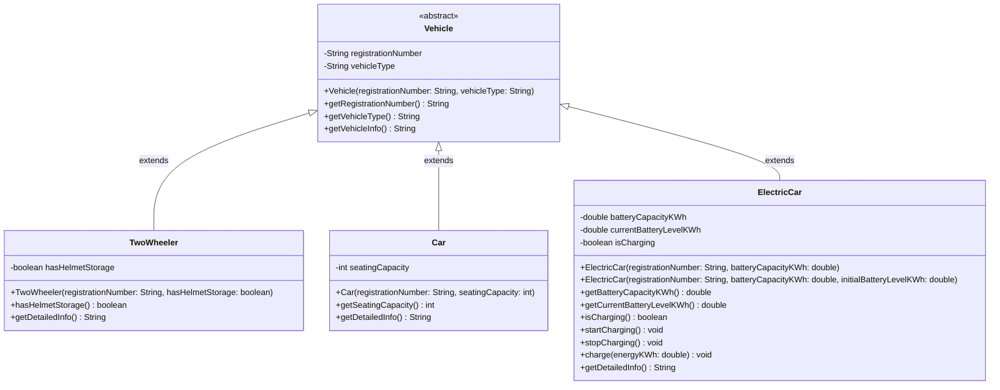

# Task 6: Design the Inheritance Hierarchy

---

## 1. Superclass and Subclasses

### 1.1 Architectural Overview and Inheritance Classification

In the Campus Smart-Parking System, vehicles entering the campus facility share common identity attributes (such as registration numbers and categorization) but exhibit specialized physical characteristics and operational needs (such as helmet storage for two-wheelers, seating capacity for passenger cars, and battery capacity/charging controls for electric vehicles).

To model this domain, an **abstract superclass `Vehicle`** is designed, from which three concrete subclasses inherit:
1. `TwoWheeler`
2. `Car`
3. `ElectricCar`

```
                        +----------------------------+
                        |      <<abstract>>          |
                        |          Vehicle           |
                        +----------------------------+
                                      ^
                                      |
         +----------------------------+----------------------------+
         | (Hierarchical)             | (Hierarchical)             | (Hierarchical)
+-----------------+          +-----------------+          +-----------------+
|   TwoWheeler    |          |       Car       |          |   ElectricCar   |
+-----------------+          +-----------------+          +-----------------+
```

#### Classification of Inheritance Model
This design employs **Hierarchical Inheritance**:
- Multiple specialized subclasses (`TwoWheeler`, `Car`, and `ElectricCar`) directly extend a single common superclass (`Vehicle`).
- Each subclass forms a distinct branch of specialization under the unified `Vehicle` umbrella.
- All three subclasses share the identical polymorphic root, allowing parking slots, tickets, and facility logs to treat any incoming conveyance uniformly as a `Vehicle` reference.

### 1.2 Justification of Hierarchical Inheritance

Hierarchical inheritance is specifically chosen for the following architectural reasons:
1. **Polymorphic Abstraction:** The parking management subsystem (`ParkingFacility`, `ParkingSlot`) does not need to duplicate allocation logic for every individual vehicle category. Methods can accept or return `Vehicle`, decoupling facility management from vehicle specifics.
2. **Elimination of Redundant Code:** Common identity verification, registration number validation, and base string formatting are implemented once in `Vehicle` and automatically inherited by all subclasses.
3. **Open for Extension:** When new campus vehicle types are introduced in the future (such as bicycles, campus shuttles, or delivery vans), new subclasses can extend `Vehicle` without modifying existing vehicle implementations.

### 1.3 Relationship to Task 1 Candidate Classes (`ElectricVehicle` vs. `ElectricCar`)

In Task 1 (Problem Analysis), the candidate class `ElectricVehicle` was identified conceptually to represent conveyances requiring dedicated EV charging infrastructure.

In Task 6, the concrete class is named `ElectricCar`:
- **Design Alignment:** The initial campus deployment specifically supports electric passenger cars utilizing standard charging slots.
- **Consistency:** Naming the class `ElectricCar` clarifies that it represents automobile-grade EVs equipped with high-capacity battery packs (measured in kWh) and charging state management, while retaining direct inheritance from `Vehicle`.
- If two-wheeled electric scooters (e-bikes) are integrated later (e.g., in Day-4 Challenge), an `ElectricTwoWheeler` or broader `ElectricVehicle` interface/abstraction can seamlessly fit into this hierarchical root.

### 1.4 Inherited vs. Subclass-Specific State and Behaviour

> [!NOTE]
> In accordance with the assignment progression, method overrides for `toString()`, `equals()`, and `hashCode()` are explicitly reserved for **Task 7**. Subclasses in Task 6 focus strictly on constructor chaining, state specialization, and domain behaviour.

| Class | Role | Inherited Members (from `Vehicle`) | Subclass-Specific Additions | Responsibility |
| :--- | :--- | :--- | :--- | :--- |
| **`Vehicle`** | Abstract Superclass | *N/A (Root of hierarchy)* | - `registrationNumber: String`<br>- `vehicleType: String`<br>- `getRegistrationNumber()`<br>- `getVehicleType()`<br>- `getVehicleInfo()` | Encapsulates immutable identity and category invariants for all campus vehicles. |
| **`TwoWheeler`** | Concrete Subclass | - `registrationNumber`<br>- `vehicleType`<br>- `getRegistrationNumber()`<br>- `getVehicleType()`<br>- `getVehicleInfo()` | - `hasHelmetStorage: boolean`<br>- `hasHelmetStorage()`<br>- `getDetailedInfo()` | Models motorcycles and mopeds; tracks helmet boot/box storage availability. |
| **`Car`** | Concrete Subclass | - `registrationNumber`<br>- `vehicleType`<br>- `getRegistrationNumber()`<br>- `getVehicleType()`<br>- `getVehicleInfo()` | - `seatingCapacity: int`<br>- `getSeatingCapacity()`<br>- `getDetailedInfo()` | Models passenger automobiles; tracks verified passenger seating capacity. |
| **`ElectricCar`** | Concrete Subclass | - `registrationNumber`<br>- `vehicleType`<br>- `getRegistrationNumber()`<br>- `getVehicleType()`<br>- `getVehicleInfo()` | - `batteryCapacityKWh: double`<br>- `currentBatteryLevelKWh: double`<br>- `isCharging: boolean`<br>- `startCharging()`<br>- `stopCharging()`<br>- `charge(energyKWh)`<br>- `getDetailedInfo()` | Models electric cars; manages battery capacity, current state-of-charge, and charging connections. |

---

## 2. Use of the `super` Keyword

In Java, the `super` reference variable is used inside subclass implementations to refer directly to the immediate superclass. It serves two distinct purposes:
1. Delegating constructor execution via `super(...)`.
2. Accessing inherited superclass methods.

### 2.1 Constructor Delegation via `super(...)`

When an object of a subclass is created, its superclass constructor must execute first to ensure the base object state is properly established.

```java
public class ElectricCar extends Vehicle {
    private final double batteryCapacityKWh;

    public ElectricCar(String registrationNumber, double batteryCapacityKWh) {
        // super(...) MUST be the very first statement in the constructor body
        super(registrationNumber, "ELECTRIC_CAR");

        if (batteryCapacityKWh <= 0) {
            throw new IllegalArgumentException("Battery capacity must be strictly positive.");
        }
        this.batteryCapacityKWh = batteryCapacityKWh;
    }
}
```

Rules enforced by the Java language:
- `super(...)` invokes the matching parameterized constructor of `Vehicle`.
- It **must be the first syntactic statement** in the subclass constructor. This guarantees that superclass invariants are validated and fields are populated before subclass constructor logic begins.
- If a subclass constructor does not explicitly invoke `super(...)` or `this(...)`, the Java compiler automatically inserts an implicit call to `super()`. Because `Vehicle` has no no-argument default constructor, explicit invocation of `super(registrationNumber, type)` is mandatory.

### 2.2 Accessing Inherited Behaviour via `super.method()`

Subclasses can reuse and build upon superclass method implementations using `super.methodName()`:

```java
// Inside TwoWheeler.java
public String getDetailedInfo() {
    // Reuses the baseline information formatted by Vehicle
    return super.getVehicleInfo() + ", Helmet Storage: " + (hasHelmetStorage ? "Yes" : "No");
}
```

This prevents duplicate string construction logic while allowing subclasses to append specialized details cleanly.

### 2.3 Field Access and Encapsulation Integrity

> [!IMPORTANT]
> **Encapsulation Boundary:** In `Vehicle`, fields `registrationNumber` and `vehicleType` are declared `private`.
> Consequently, subclasses cannot directly access `super.registrationNumber` or modify superclass fields.

Why this design maintains architectural integrity:
- **Direct access (`super.registrationNumber`) is forbidden by the compiler** because `private` members are visible only within the declaring class (`Vehicle`).
- Subclasses access inherited state exclusively through **public accessor methods** (`getRegistrationNumber()`, `getVehicleType()`).
- Weakening field visibility from `private` to `protected` merely to demonstrate `super.field` is an anti-pattern. Leaving fields `private` protects class invariants from arbitrary alteration by subclasses, maintaining encapsulation.

---

## 3. `ElectricCar` Constructor Execution Trace

When the runtime statement:

```java
ElectricCar ev = new ElectricCar("TN11EF9012", 60.0, 30.0);
```

is executed, the Java Virtual Machine adheres to a strict, deterministic initialization sequence defined by the Java Language Specification (JLS §12.5):

```
[ Step 1: Memory Allocation & Default Initialization ]
  ├── Heap allocates memory block for the ElectricCar object instance
  └── All instance fields (from Object, Vehicle, down to ElectricCar) are zeroed:
        registrationNumber = null
        vehicleType = null
        batteryCapacityKWh = 0.0
        currentBatteryLevelKWh = 0.0
        isCharging = false

[ Step 2: ElectricCar Constructor Invocation ]
  └── ElectricCar("TN11EF9012", 60.0, 30.0) constructor pushed onto thread stack
        └── First statement delegates immediately via super("TN11EF9012", "ELECTRIC_CAR")

[ Step 3: Vehicle Constructor Invocation & Object Constructor ]
  └── Vehicle("TN11EF9012", "ELECTRIC_CAR") pushed onto stack
        └── Vehicle constructor delegates implicitly via super() to java.lang.Object()
              └── java.lang.Object constructor executes and completes

[ Step 4: Vehicle Instance Initialization & Constructor Body ]
  ├── Vehicle instance field initializers execute (if any)
  ├── Vehicle constructor body executes:
  │     - Validates non-null / non-blank inputs
  │     - Assigns this.registrationNumber = "TN11EF9012"
  │     - Assigns this.vehicleType = "ELECTRIC_CAR"
  └── Vehicle constructor finishes and pops from stack

[ Step 5: ElectricCar Instance Initialization & Constructor Body ]
  ├── ElectricCar instance field initializers execute:
  │     - isCharging = false (default field initialization)
  ├── ElectricCar constructor body executes:
  │     - Validates batteryCapacityKWh > 0 and 0 <= initialBatteryLevel <= capacity
  │     - Assigns this.batteryCapacityKWh = 60.0
  │     - Assigns this.currentBatteryLevelKWh = 30.0
  └── ElectricCar constructor finishes and pops from stack

[ Step 6: Object Reference Returned ]
  └── Fully initialized ElectricCar reference is assigned to local variable 'ev'
```

### Detailed Execution Trace Table

| Phase | Action / Call Stack | Field State in Heap | Description |
| :---: | :--- | :--- | :--- |
| **1** | Heap Allocation | `regNo=null`, `type=null`, `cap=0.0`, `level=0.0`, `charging=false` | Heap allocates memory for the instance. All fields across the entire object layout are set to binary zero/null defaults. |
| **2** | `ElectricCar(...)` Invocation | *(same as above)* | Constructor receives parameters (`"TN11EF9012"`, `60.0`, `30.0`). First statement `super(...)` is evaluated. |
| **3** | `Vehicle(...)` Invocation | *(same as above)* | Superclass constructor receives (`"TN11EF9012"`, `"ELECTRIC_CAR"`). Delegates to `Object()` via implicit `super()`. |
| **4** | `Object()` Execution | *(same as above)* | Top of the object hierarchy executes; initializes JVM internal object headers and monitors. |
| **5** | `Vehicle` Body Execution | `regNo="TN11EF9012"`, `type="ELECTRIC_CAR"`, `cap=0.0`, `level=0.0`, `charging=false` | Parameter validation passes; `this.registrationNumber` and `this.vehicleType` are assigned. Control returns to `ElectricCar`. |
| **6** | `ElectricCar` Field Initializers | `regNo="TN11EF9012"`, `type="ELECTRIC_CAR"`, `cap=0.0`, `level=0.0`, `charging=false` | Instance variable initializers execute in textual declaration order (`this.isCharging = false`). |
| **7** | `ElectricCar` Body Execution | `regNo="TN11EF9012"`, `type="ELECTRIC_CAR"`, `cap=60.0`, `level=30.0`, `charging=false` | Subclass constructor body validates battery parameters and assigns `this.batteryCapacityKWh` and `this.currentBatteryLevelKWh`. |
| **8** | Completion | Final initialized object | `ElectricCar` constructor body completes; reference to the fully constructed object is returned. |

> [!NOTE]
> **Tracing Subclasses:** If a diagnostic helper subclass (such as `TracedElectricCar`) is used to observe constructor execution, its constructor body runs strictly **after** `ElectricCar`'s constructor body has completed. The `TracedElectricCar` constructor body must never be confused with the `ElectricCar` constructor body.

---

## 4. UML Class Diagram

The PlantUML source specification is saved in:
[`docs/uml/task06-inheritance-hierarchy.puml`](file:///Users/hasinnn/Documents/Java%20Assignment%201/docs/uml/task06-inheritance-hierarchy.puml)

### Readable Markdown Diagram (Mermaid)



---

## 5. Alternative Concept and Complexity Analysis: Composition

The assignment specification requires comparing the implemented **Inheritance Design** against an alternative **Composition Design**:
- **Inheritance:** `Car is-a Vehicle`
- **Composition:** A single `Vehicle` class that `has-a VehicleType` object holding rate and category data.

```
INHERITANCE (is-a):
+---------------------------------------+
| Single Contiguous Object on Heap      |
|   Vehicle Header                      |
|   registrationNumber = "TN01AB1234"   |
|   vehicleType = "CAR"                 |
|   seatingCapacity = 5                 |
+---------------------------------------+

COMPOSITION (has-a):
+---------------------------------------+         +-------------------------------+
| Vehicle Object on Heap                |         | VehicleType Object on Heap    |
|   Vehicle Header                      |         |   VehicleType Header          |
|   registrationNumber = "TN01AB1234"   |         |   typeName = "CAR"            |
|   typeRef ----------------------------+-------->|   baseRate = 20.0             |
+---------------------------------------+         +-------------------------------+
```

### 5.1 Conceptual Modeling: `is-a` vs. `has-a`

- **Inheritance (`is-a`):**
  - Represents a strict taxonomic classification. A `Car` *is a* `Vehicle`. An `ElectricCar` *is a* `Vehicle`.
  - Behaviour and state specific to cars (e.g., seating capacity) or electric cars (e.g., battery kWh, charging ports) live directly within the subclass.
  - Subclasses can easily specialize operations and enforce compile-time type safety.

- **Composition (`has-a`):**
  - Represents a component/delegation relationship. A generic `Vehicle` object *has a* reference to a `VehicleType` configuration object.
  - `VehicleType` holds shared categorical attributes (such as hourly billing rate, category label, size classification).
  - Promotes dynamic flexibility: a vehicle's category or rate policy could theoretically be swapped at runtime by reassigning the `typeRef` reference.

### 5.2 Work Required to Add a New Vehicle Type

Suppose the university introduces a new vehicle category, such as a **Delivery Van** or an **Electric Bike**:

| Modification Aspect | Inheritance Design (`is-a`) | Composition Design (`has-a`) |
| :--- | :--- | :--- |
| **New Classes Created** | **1 new class** (e.g., `DeliveryVan extends Vehicle`). | **0 new classes** (Instantiate an existing `VehicleType` with new parameters, e.g., `new VehicleType("VAN", 30.0)`). |
| **Existing Code Modified** | **0 existing classes modified.** Follows the Open/Closed Principle (open for extension, closed for modification). Existing `TwoWheeler`, `Car`, and `Vehicle` classes remain untouched. | **0 classes modified** if `VehicleType` holds all necessary data; however, if the new vehicle requires unique physical behaviour (e.g. refrigeration unit power monitoring), `Vehicle` itself must be modified with optional fields. |
| **Specialized Attributes** | Trivial and clean: Subclass adds unique fields (e.g., `maxCargoWeightKg` in `DeliveryVan`) without polluting other vehicle types. | Difficult: Because there is only one `Vehicle` class, specialized fields must either be added to `Vehicle` (leaving them unused/null for cars and bikes) or stored in generic property maps. |

### 5.3 Complexity Analysis: Time and Space Comparison

Let:
- $k$ be the number of distinct vehicle types registered in the system.
- $n$ be the total number of individual vehicle objects currently in memory.

#### Assumptions
1. Vehicles are stored and accessed in memory.
2. In the composition model, `VehicleType` objects are flyweights or shared instances referenced by multiple vehicles.
3. In both models, accessing an instance field or invoking a non-virtual/direct method takes constant time.

#### 1. Time Complexity to Compute Fee
- **Inheritance:**
  The calculation accesses the vehicle's specific attributes directly. In Task 6 (and Task 7 polymorphic dispatch), invoking fee logic on a vehicle takes $\mathcal{O}(1)$ time. It requires a single method call resolved via direct or vtable dispatch.
- **Composition:**
  The vehicle delegates to its contained `VehicleType`: `this.vehicleType.getBaseRate()`. Dereferencing the pointer and accessing the rate takes $\mathcal{O}(1)$ constant time.
- **Comparison:**
  Both designs perform fee calculation in $\mathcal{O}(1)$ time, independent of the number of vehicle types $k$.

#### 2. Space Complexity per Vehicle Object
- **Inheritance:**
  - Each vehicle instance is allocated as a **single, contiguous object on the heap**.
  - Contains object header, superclass fields (`registrationNumber`, `vehicleType`), and subclass-specific fields (`seatingCapacity` or `batteryCapacityKWh`).
  - Total heap pointers per vehicle: **0 auxiliary reference pointers** between vehicle parts.
  - Overall storage for $n$ vehicles: $\mathcal{O}(n)$.
- **Composition:**
  - Each vehicle requires a `Vehicle` instance containing its registration number and a reference pointer `typeRef`.
  - The `typeRef` points to a separate `VehicleType` object on the heap.
  - Even if the $k$ `VehicleType` objects are shared flyweights ($\mathcal{O}(k)$ total space for types), each `Vehicle` instance incurs the memory cost of an **extra reference pointer** plus the overhead of pointer indirection.
  - Overall storage for $n$ vehicles: $\mathcal{O}(n + k)$. Since $k \ll n$, asymptotic space is $\mathcal{O}(n)$, but with slightly higher heap overhead due to separate object references.

### 5.4 Architectural Trade-Off Summary

| Evaluation Criteria | Inheritance (`Car is-a Vehicle`) | Composition (`Vehicle has-a VehicleType`) |
| :--- | :--- | :--- |
| **Conceptual Fit** | Natural domain taxonomy (`Car` is fundamentally a vehicle). | Good for pricing/metadata; unnatural for diverse physical attributes. |
| **Specialized State** | High: Each subclass cleanly encapsulates its unique attributes. | Poor: Cannot cleanly support vehicle-specific fields without nullable fields in `Vehicle`. |
| **Fee Calculation Time** | $\mathcal{O}(1)$ constant time. | $\mathcal{O}(1)$ constant time (one pointer dereference). |
| **Space per Object** | $\mathcal{O}(1)$ single contiguous object on heap. | $\mathcal{O}(1)$ object + reference pointer to `VehicleType`. |
| **Adding New Types** | Create a clean subclass; no existing code touched. | Instantiate `VehicleType`; cannot easily add type-specific logic. |
| **Runtime Mutability** | Class identity is immutable once constructed. | Type or pricing policy can be changed dynamically by updating reference. |

> [!TIP]
> **Conclusion:** For a smart-parking system where vehicles possess distinct physical properties and hardware requirements (such as electric vehicles needing charging slots and tracking battery levels, while two-wheelers need helmet storage), **Hierarchical Inheritance** is the superior object-oriented architecture.
